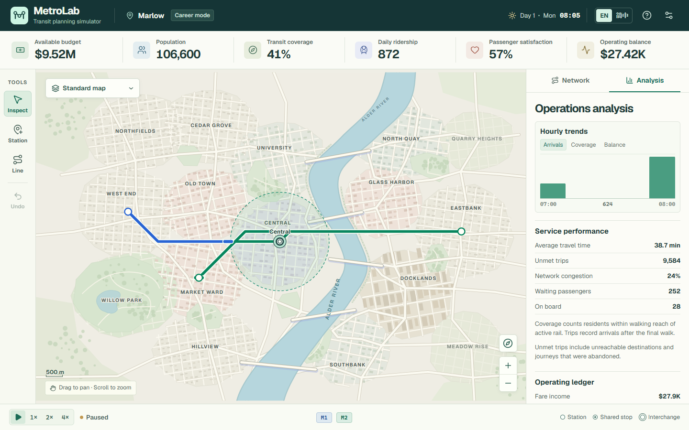

# MetroLab

English · [简体中文](README.zh-CN.md)

MetroLab is a browser-based metro planning and operations game. Build stations in Marlow, a growing river city, connect them into lines, and pay for a service that can handle the morning rush. Your decisions affect who can walk to a station, how long passengers wait, where they transfer, and how much the network costs to run.

## Screenshots




## Live demo

The GitHub Pages workflow publishes the project site. The workflow's deployment environment reports the playable URL when its first deployment succeeds.

## Design motivation

MetroLab brings the clarity of a schematic rail map to a city whose geography matters. The Alder River shapes both walk access and construction cost. Neighborhoods have different mixes of residents, jobs and attractions, so a cheap route, a busy route and a financially sustainable route can be three different designs.

## Play

1. Start **Career** with a $20 million construction budget and city milestones, or start **Sandbox** with unrestricted funding. Both modes open with an unserved version of Marlow.
2. Check the population and demand layers. Choose **Station** and hover over land to see the estimated catchment and cost before placing a station.
3. Choose **Line**. Click stations in order or drag across them. Use the stop list to reorder, insert or remove stops, or connect at least three stations into a loop. Build the line from the inspector.
4. Buy trains and set the first terminal's dispatch interval. When two lines serve a station, build an interchange to allow passengers to transfer there.
5. Run the clock. Use the Analysis tab and the congestion layer to inspect ridership, travel time, missed trips, expenses and queue pressure as the city develops.

Use **V**, **S** and **L** to switch tools, **Space** to pause or run, and **Esc** to cancel. **Ctrl/⌘+Z** undoes draft edits or recent edits made while paused. Drag the map to pan and use the mouse wheel or map controls to zoom. The example network on the main menu is an inspectable simulation snapshot.

Settings provide manual save, load and reset. The game autosaves every nine seconds while the workspace is open and when leaving it. The language switch preserves the network, clock and player-defined names.

## Technical architecture

- **React, TypeScript and Vite** render the interface and SVG map. The city map uses authored districts, procedural building footprints, streets, parks, bridges and a winding river.
- **`src/engine/`** contains city development, network edits, passenger generation, routing, train operations, economy, analytics and versioned LocalStorage saves.
- **`src/ui/`** contains map interaction, SVG rendering, planning tools, inspectors, charts and the simulation clock.
- **`src/locales/`** contains English and Simplified Chinese resources used by i18next. The game ships as static assets and plays without an account or runtime API.
- **`tests/`** covers engine invariants and the end-to-end Chromium workflow. Deployment uses the Vite base path `/MetroLab/`.

## Simulation methodology

Marlow starts with 106,600 residents across 14 developed districts, plus two future development areas. Every five simulated minutes, weighted origin–destination pairs produce grouped trips. Job demand peaks during weekday commutes. Retail, parks and public facilities attract weekend trips. Fractional carry keeps rounding deterministic. Night service has lower demand.

Walk access uses sampled district locations, station catchment radii and bridge-aware distances. Coverage counts the population within walking reach of an active line, with overlapping catchments counted once. Dijkstra compares walk time, estimated waits, ride time, congestion and transfer penalties on a directed service graph. Shared stations support transfers once their interchange is built.

Trains board up to their capacity when they depart and let passengers alight at the end of each leg. Groups wait for connecting trains or complete the final walk before earning a fare. Unreachable, rejected and abandoned trips contribute to today's unmet demand. Recorded journeys determine average travel time, while the satisfaction score combines completed trip time with the share of unmet trips.

Construction charges reflect length and river crossings. Fare revenue and coverage-linked subsidies support maintenance and train operations. The ledger also records upgrades, vehicle purchases, city grants and salvage. At midnight, development increases residents and jobs, with stronger growth where active rail is reachable. Hourly trend samples retain the latest 48 observations.

## Local development

Use Node.js 24 or later and npm.

```sh
npm ci
npm run dev
npm test
npm run build
```

Open the Vite URL ending in `/MetroLab/`. To test the production build, run `npm run preview` and open its URL. To run the browser smoke test against that preview, run `npm run test:browser` in another terminal. Set `METROLAB_CHROME` if Chromium is installed at a custom path. `METROLAB_URL` overrides the preview URL and `METROLAB_SCREENSHOTS` enables screenshot output to the given directory.

## Deployment

The Pages workflow runs tests and builds on pull requests and on pushes to `main`. A successful build from `main` publishes `dist/` to GitHub Pages. For a new repository, select **GitHub Actions** as the Pages source. Change `base` in `vite.config.ts` if the project is published under another path. [Vite deployment guide](https://vite.dev/guide/static-deploy.html#github-pages)

## Current limitations

- Marlow is the included city. District development increases capacity and opens two authored areas over time.
- Demand uses district groups and sampled walk access. Trains move independently of signals, block occupancy and track conflicts. Circular services run in one direction.
- Redesigning a service restarts its trains and counts interrupted affected trips as unmet. The browser keeps one local save slot per site origin.
- Desktop is the primary editing layout. Smaller screens stack the inspector below the map.

## Roadmap

1. Add train spacing, track occupancy and more detailed dispatch controls.
2. Extend the scenario format for new maps and a city editor.
3. Add explicit walking routes, richer land-use changes and more career objectives.

MetroLab is MIT-licensed. The Geist font and Lucide icons carry their own notices. [Game license](LICENSE) · [Third-party notices](public/third-party-notices.txt)
