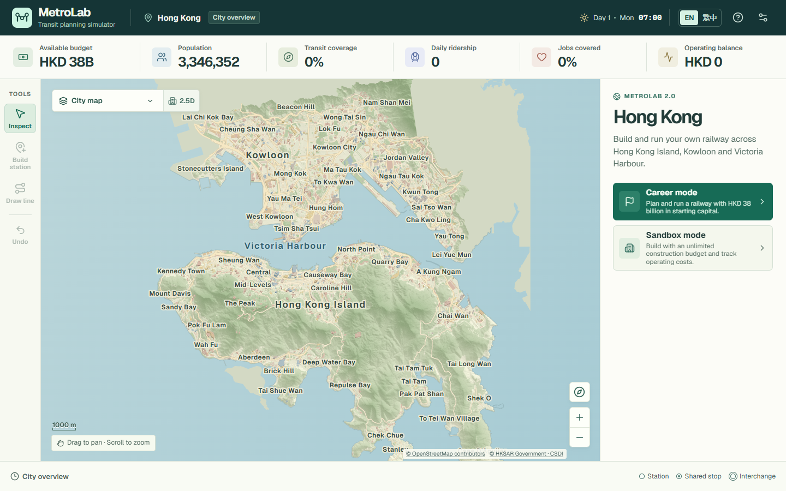
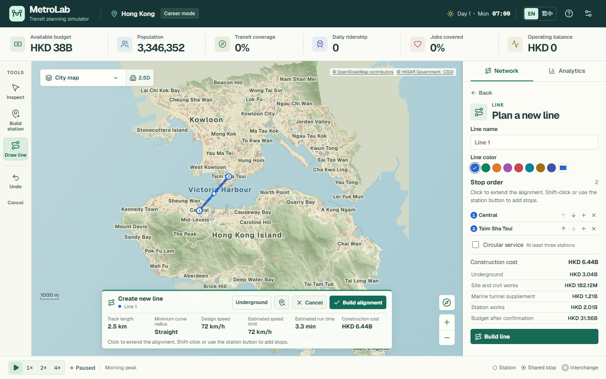

# MetroLab 2.0 · Hong Kong

[繁體中文](README.zh-HK.md)

MetroLab is a browser-based railway planning and operations game set on Hong Kong Island and in Kowloon. Design your own network around Victoria Harbour, adapt to the terrain and streets, and set fares and frequency to serve the trips people make. The scenario starts with an empty railway network and uses modern geography with 2021 population and employment controls.

[Play MetroLab](https://bruce666-ppp.github.io/MetroLab/) · [Data, licensing and simulation](docs/HONG-KONG-DATA.md)



## Build and operate

1. Start **Career** with HKD 38 billion or **Sandbox** with unlimited construction funding. Explore the city map and the population, employment and travel demand layers. Select a statistical area to see the modelled trips it generates.
2. Choose **Draw line**. Ordinary clicks add alignment points. Shift-click or use the station button in the planning dock to add an explicit stop. You can confirm track first, then add stations later. Start from an eligible existing terminal to extend its line.
3. Select underground, elevated or at-grade construction. Underground construction can cross Victoria Harbour as a marine tunnel. The preview gives alignment length, engineering constraints and remaining budget. The line editor shows the cost by method, site works, marine tunnel and station works. Confirm the plan to spend the quoted amount.
4. Choose **Build station** for a standalone station or to insert a stop on built track. Select the participating lines where alignments overlap. Stations receive editable Chinese and English names from their surroundings. Use the inspector to edit alignments, extend or remove track, or relocate stations.
5. Buy trains and set the dispatch interval and fare. Run the clock, then use the operating dashboard and passenger-flow map to check service, crowding and the daily balance. Each completed journey earns its fare. Active service, trains, tracks and stations introduce operating costs.

**V** inspects the map, **S** opens the station tool, **L** draws a line, **Space** runs or pauses the clock, and **Esc** cancels. **Ctrl/⌘+Z** undoes draft edits or recent construction while time is paused. Drag to pan and use the wheel or zoom buttons to zoom. The map can switch between raised and plan views.



## City data and save files

The map combines official Lands Department terrain, surveyed building footprints and names with OpenStreetMap roads, shoreline and places. It uses 2021 Census population for 105 playable statistical areas and the Planning Department's 2021 employment estimates for nine districts. Grid allocation and travel demand are model estimates. The demand model follows residential, employment, school, retail, health and leisure patterns calibrated against the Transport Department travel survey. [The data guide](docs/HONG-KONG-DATA.md)

The game uses a single LocalStorage slot with timed autosaves and manual save, load and reset in Settings. Schema 4 opens existing Marlow saves from schemas 1–3. English and Hong Kong Traditional Chinese switch independently of the game state. The V2.0 construction and operations are available in the Hong Kong scenario.

## Development and publishing

Use Node.js 24 or later and npm with the data included in this repository.

```sh
npm ci
npm test
npm run build
npm run preview
```

Run `npm run test:browser` against the preview from another terminal. `METROLAB_CHROME` selects a Chromium executable, `METROLAB_URL` changes the test URL and `METROLAB_SCREENSHOTS` sets the screenshot directory. Use `npm run dev` for the development server. The Vite base path remains `/MetroLab/`. GitHub Actions tests and builds pull requests and publishes the static build from `main`. [Deployment workflow](.github/workflows/pages.yml)

The independent TypeScript engine includes engineering geometry, walk access, passenger routing, trains, finance and save migrations. React and Canvas draw the map, with survey-aligned SVG tracks and station markers. A worker advances the Hong Kong simulation during normal play. [Rebuild the geographic data](docs/HONG-KONG-DATA.md#rebuild-the-published-assets)

The railway uses tangent-connected circular arcs and a 250 m lower curve-radius limit. Signal blocks, junction conflicts, vertical track profiles and transition spirals are outside the engineering model. School, retail and clinical capacities come from the activity model. Bus and ferry data are represented through approximate travel alternatives and there is one local save slot per site origin.

The application is MIT-licensed. Map datasets and third-party fonts and icons have separate terms. [Game licence](LICENSE) · [Third-party notices](public/third-party-notices.txt) · [Map attribution](public/data/hong-kong/attribution.html)
