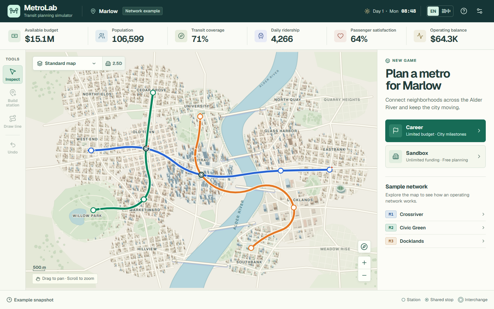
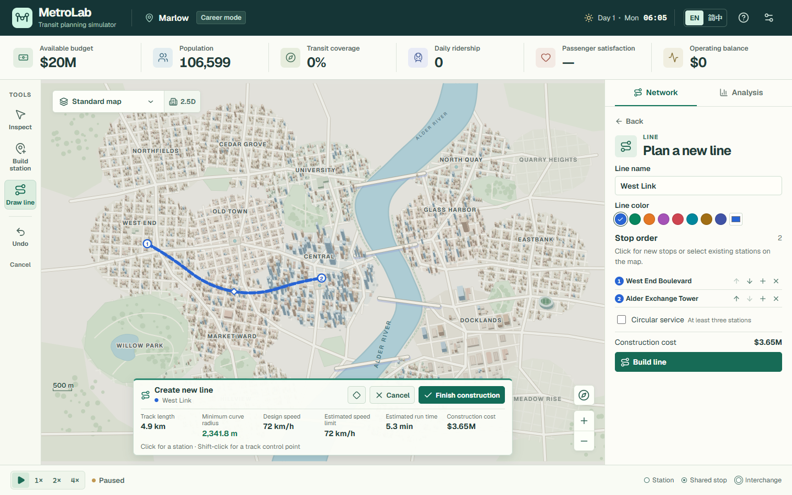

# MetroLab

English · [简体中文](README.zh-CN.md)

MetroLab is a browser-based metro planning and operations game. Build stations in Marlow, a growing river city, connect them into lines, and pay for a service that can handle the morning rush. Your decisions affect who can walk to a station, how long passengers wait, where they transfer, and how much the network costs to run.

## Screenshots






## Live demo

Play MetroLab in your browser. [Open the live game](https://bruce666-ppp.github.io/MetroLab/)

## Design motivation

MetroLab brings the clarity of a schematic rail map to a city whose geography matters. The Alder River shapes both walk access and construction cost. Neighborhoods have different mixes of residents, jobs and attractions, so a cheap route, a busy route and a financially sustainable route can be three different designs.

## Play

1. Start **Career** with a $20 million construction budget and city milestones, or start **Sandbox** with unrestricted funding. Both modes open with an unserved version of Marlow.
2. Choose **Draw line** and click the map to place stops. Click or drag across existing stations to connect them. Hold **Shift** or select the diamond control in the dock to add a waypoint for the track between stations.
3. Starting at an existing terminal offers a line extension. Use the dock to switch to a new line or choose a different eligible terminal service. Starting at an intermediate stop creates a new line and includes interchange construction. The dock shows the length, minimum radius, speed limit, run time and cost. Press **Enter** or **Finish construction** to build.
4. Use **Build station** on land for an independent stop or on a rail alignment to add a stop to a line. Select the participating lines when tracks coincide. Use the right panel to rename stations and lines, recolor a line or edit its order, loop and track control points.
5. Buy trains, set the terminal dispatch interval and run the clock. The **Track engineering** layer highlights bends by severity. The Analysis tab shows ridership, travel time, missed trips, expenses and queue pressure as the city develops.

Use **V**, **S** and **L** to switch tools, **Space** to pause or run, and **Esc** to cancel. **Ctrl/⌘+Z** undoes draft edits or recent edits made while paused. Drag the map to pan and use the mouse wheel or map controls to zoom. The example network on the main menu is an inspectable simulation snapshot.

Settings provide manual save, load and reset. The game autosaves every nine seconds while the workspace is open and when leaving it. The language switch preserves the map view, current draft, network, clock and player-defined names. Geographic station and route names follow the selected language.

## Technical architecture

- **React, TypeScript and Vite** render the interface and SVG map. Deterministic street-constrained lots generate a mix of low-rise terraces, residential and office towers, retail blocks and industrial sheds. Named institutions, public spaces and the stadium are part of the same city model.
- **2.5D and plan view** share a ground plane. Roofs, facades and shadows add depth above it. Rails and trains are drawn above the city, and engineering uses the survey scale of ten meters per world unit.
- **`src/engine/`** contains city development, network edits, passenger generation, routing, train operations, economy, analytics and versioned LocalStorage saves.
- **`src/ui/`** contains map interaction, SVG rendering, planning tools, inspectors, charts and the simulation clock.
- **`src/locales/`** contains English and Simplified Chinese resources used by i18next. The game ships as static assets and plays without an account or runtime API.
- **`tests/`** covers engine invariants and the end-to-end Chromium workflow. Deployment uses the Vite base path `/MetroLab/`.

## Simulation methodology

Marlow starts with about 106,600 residents across 14 developed districts, plus two future development areas. Building use and floor area determine the district's residents, jobs, visitor attraction and school places. Every five simulated minutes, weighted origin–destination pairs produce grouped trips. Homes and offices drive weekday commutes, schools add morning and afternoon trips, and shops and leisure destinations draw afternoon and weekend travel. Fractional carry keeps rounding deterministic.

Straight segments and tangent-connected circular arcs are stored for each section. Arc length is radius multiplied by the absolute sweep angle in radians. New construction and rebuilt sections require a minimum radius of **250 m**. Green marks straight track or radii of at least 600 m, yellow covers 400 to under 600 m, and orange covers 250 to under 400 m. Red marks a disallowed turn or legacy corner. [Biarc interpolation](https://www.ryanjuckett.com/biarc-interpolation/)

The curve speed limit is the smaller of 72 km/h and 3.6 times the square root of the radius in meters multiplied by a game lateral acceleration of 0.53 m/s². The vehicle's maximum imposes a further cap. The running profile propagates acceleration forward and braking backward along the track. Train motion, travel-time estimates, fleet cycle, effective headway, capacity and passenger route choice use that profile. [Circular motion and centripetal acceleration](https://openstax.org/books/university-physics-volume-1/pages/4-4-uniform-and-nonuniform-circular-motion)

Walk access uses sampled district locations, station catchment radii and bridge-aware distances. Coverage counts the population within walking reach of an active line, with overlapping catchments counted once. Dijkstra compares walk time, estimated waits, ride time, congestion and transfer penalties on a directed service graph. Shared stations support transfers once their interchange is built.

Trains board up to their capacity when they depart and let passengers alight at the end of each leg. Groups wait for connecting trains or complete the final walk before earning a fare. Unreachable, rejected and abandoned trips contribute to today's unmet demand. Recorded journeys determine average travel time, while the satisfaction score combines completed trip time with the share of unmet trips.

Construction charges reflect length and river crossings. Fare revenue and coverage-linked subsidies support maintenance and train operations. The ledger also records upgrades, vehicle purchases, city grants and salvage. At midnight, development increases residents and jobs, with stronger growth where active rail is reachable. Hourly trend samples retain the latest 48 observations.

## Local development

Use Node.js 24 or later and npm.

```sh
npm ci
npm run dev
npm test
npm run build
```

Open the Vite URL ending in `/MetroLab/`. To test the production build, run `npm run preview` and open its URL. To run the browser smoke test against that preview, run `npm run test:browser` in another terminal. Set `METROLAB_CHROME` if Chromium is installed at a custom path. `METROLAB_URL` overrides the preview URL and `METROLAB_SCREENSHOTS` enables screenshot output to the given directory.

## Deployment

The Pages workflow runs tests and builds on pull requests and on pushes to `main`. A successful build from `main` publishes `dist/` to GitHub Pages. For a new repository, select **GitHub Actions** as the Pages source. Change `base` in `vite.config.ts` if the project is published under another path. [Vite deployment guide](https://vite.dev/guide/static-deploy.html#github-pages)

## Current limitations

- Marlow is the included city. District development increases capacity and opens two authored areas over time.
- Demand uses district groups and sampled walk access. Circular services run in one direction.
- The railway model uses game limits and tangent-connected arcs. Signal blocks, track conflicts and transition spirals are future work.
- Terminal extension preserves the existing track and service. Mid-line station insertion splits the alignment in place and keeps train positions and passenger loads. Reordering stops or changing loop service can restart affected services. The browser keeps one local save slot per site origin.
- Save schema 3 imports versions 1 and 2 with their existing track, train state and queues. Legacy corners remain operable and receive a warning. Editing their geometry applies the current construction rule.
- Desktop is the primary editing layout. Smaller screens stack the inspector below the map.

## Roadmap

1. Add train spacing, track occupancy and more detailed dispatch controls.
2. Extend the scenario format for new maps and a city editor.
3. Add explicit walking routes, richer land-use changes and more career objectives.

MetroLab is MIT-licensed. The Geist font and Lucide icons carry their own notices. [Game license](LICENSE) · [Third-party notices](public/third-party-notices.txt)
