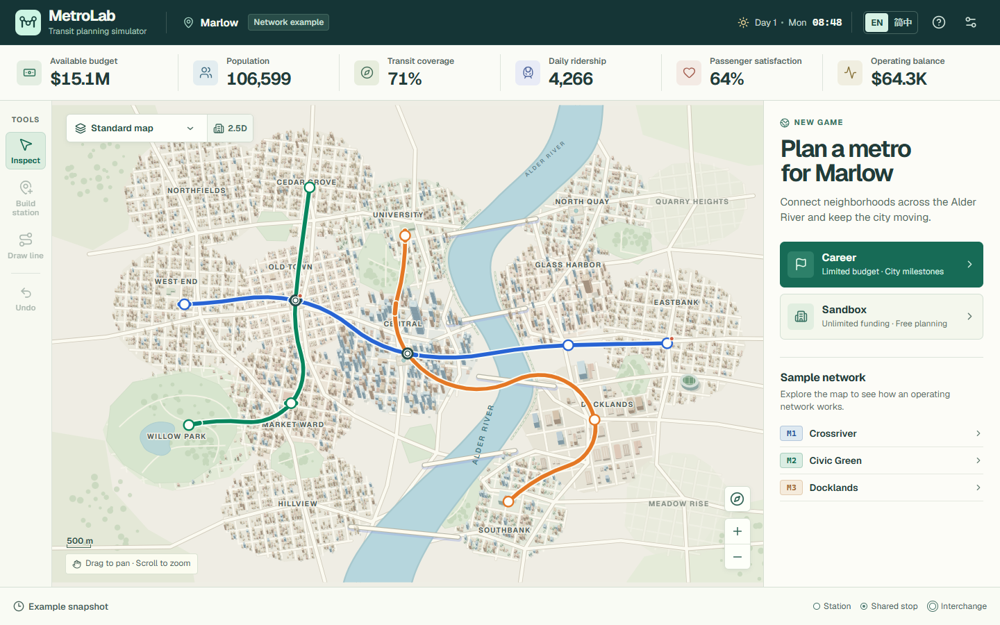
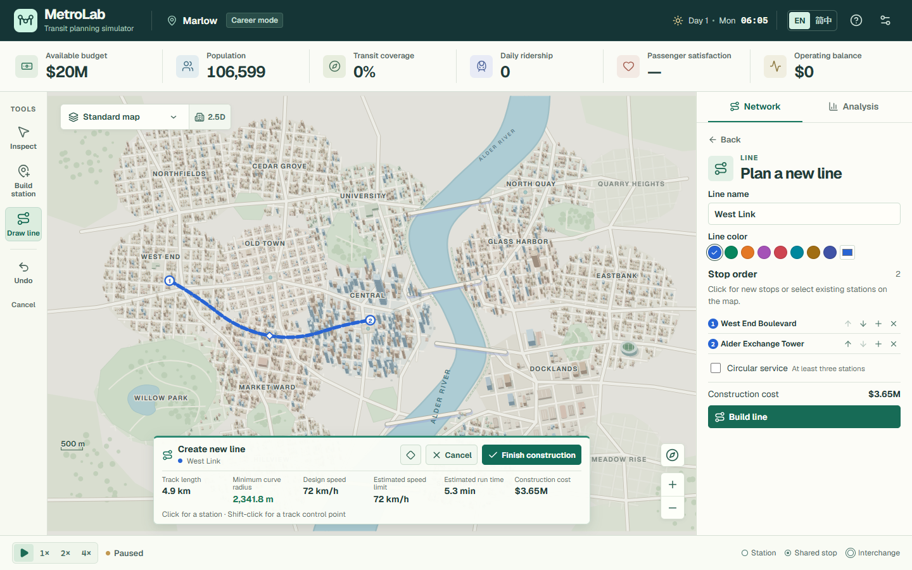
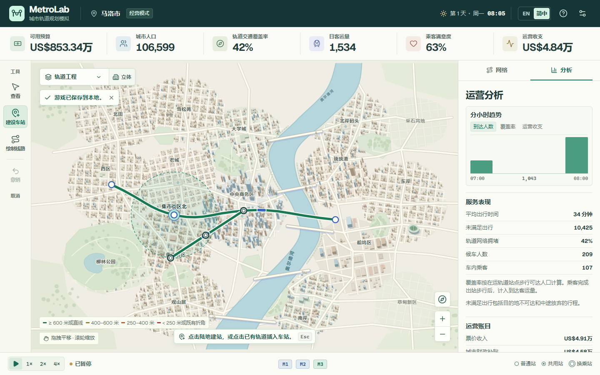

# MetroLab 城市轨道规划模拟

[English](README.md) · 简体中文

MetroLab 是一款运行在浏览器里的地铁规划与模拟经营游戏。玩家需要在河滨城市马洛选址建站、规划线路、购置列车，建立能应对通勤高峰的地铁服务。每次规划都会改变居民的步行接驳范围、候车和换乘时间，以及网络的长期运营成本。

## 实际游戏截图







## 在线游玩

在浏览器中打开 MetroLab。 [开始游戏](https://bruce666-ppp.github.io/MetroLab/)

## 设计动机

MetroLab 将示意线路图的清晰度与城市地理结合。奥尔德河既影响居民步行接驳，也影响轨道建设成本。各片区拥有不同的人口、岗位和出行目的，建设便宜、客流旺盛和财政可持续的方案需要不同的取舍。

## 游戏玩法

1. 选择 **经营模式**，使用 2,000 万美元初始预算完成城市发展目标，或选择 **沙盒模式**，在资金不限的条件下规划。两种模式均从没有地铁服务的马洛市开局。
2. 选择 **绘制线路**，在地图上点击以放置车站，也可以点击或拖过现有站点接入。按住 **Shift** 点击，或使用浮动栏里的菱形按钮，在两站之间放置轨道控制点。
3. 从既有终点站起笔时可以延长线路，并可在浮动栏切换线路或另建新线。从中途站起笔会新建线路并将接入站升级为换乘站。查看长度、最小半径、限速、运行时间和费用，再按 **Enter** 或 **完成建设**。
4. 选择 **建设车站**，在陆地建设独立站，或点击既有轨道吸附插站。多条线路共用插站位置时，可勾选参加停靠的线路。右侧面板支持自定义站名、线名、线路颜色，以及编辑停站顺序、环线和轨道控制点。
5. 购置列车并设置始发站发车间隔，随后启动时钟。用 **轨道工程** 图层查看曲线限制，用 **分析** 面板查看客运量、出行时间、未满足需求、费用和排队压力。

使用 **V**、**S**、**L** 切换工具，**空格** 暂停或继续，**Esc** 取消，**Ctrl/⌘+Z** 撤销线路草稿修改或暂停期间的近期操作。拖拽地图平移，滚轮和地图按钮用于缩放。主菜单的示例网络来自一次模拟运行，可查看站点、线路和列车详情。

在设置中可以手动保存、读取或重置。游戏打开期间每九秒自动保存，离开规划界面时也会保存。切换语言会保留地图视角、绘制草稿、网络、时钟和自定义名称。系统生成的站名和线名会随界面语言更新。

## 技术架构

- **React、TypeScript 和 Vite** 构建界面与 SVG 地图。沿道路和街区生成的建筑包括老城低层建筑、住宅和写字楼、商业楼、工业厂房，并结合学校、医院、广场和体育场等地标。
- **2.5D 与平面视图** 共用地面坐标。立体效果来自建筑顶部、侧面和投影。轨道与列车始终位于建筑上方，工程计算按每地图单位十米的比例尺进行。
- **`src/engine/`** 处理城市发展、网络编辑、客流、路径规划、列车运营、经济、指标和带版本的 LocalStorage 存档。
- **`src/ui/`** 包含地图渲染与交互、规划工具、详情面板、图表和模拟时钟。
- **`src/locales/`** 提供由 i18next 管理的英文和简体中文资源。游戏以静态文件运行，玩家无需账户或外部服务。
- **`tests/`** 包含核心算法、状态一致性和 Chromium 端到端测试。Vite 的部署路径为 `/MetroLab/`。

## 模拟方法

马洛市开局约有 10.66 万位居民、14 个已开发片区和两个后续开发区。系统根据建筑用途与楼面面积汇总居民、就业岗位、商业吸引力和学位。每五个模拟分钟，系统生成带起终点的聚合客流。住宅和办公楼带来工作日通勤，学校带来上下学客流，商场和休闲设施提高午后与周末的出行需求。小数客流跨轮累积，结果可复现。

每段轨道保存直线和切向相接的圆弧，弧长等于半径乘以转角弧度。新建和重建区段的最小圆曲线半径为 **250 米**。绿色表示直线或至少 600 米的曲线，黄色表示 400 米至不足 600 米，橙色表示 250 米至不足 400 米，红色提示超限或旧存档的折角。 [双圆弧插值原理](https://www.ryanjuckett.com/biarc-interpolation/)

游戏的曲线限速取 72 公里/小时和 `3.6 × √(0.53 × 半径米数)` 两者中的限值，车辆最高速度进一步限制实际运行。速度曲线沿线路正向约束加速、反向约束制动，使列车在弯道前减速，出弯后加速。同一速度曲线用于列车移动、运行时间、车辆周转、预计班次间隔、运力及乘客路径选择。 [向心加速度公式](https://openstax.org/books/university-physics-volume-1/pages/4-4-uniform-and-nonuniform-circular-motion)

步行接驳通过片区采样点、站点服务半径和经桥步行距离估算。覆盖率按可步行到达在运线路的人口计算，重叠区域只计一次。Dijkstra 在有方向的服务图上比较步行、候车、乘车、拥堵和换乘成本。共用站建成换乘设施后可换线。

列车发车前按剩余容量上客，到站后按乘客当前行程下客。乘客可以等候接续列车，完成目的地端步行后计入客运量和票价收入。未满足需求包含无合理路径、容量不足及中途放弃的出行。平均出行时间来自已抵达的乘客，满意度同时考虑到达耗时和未满足需求的比例。

线路建设成本取决于铺设长度和穿越河流的区间。乘客付费与覆盖率相关的补贴支持车辆运营和设施维护。账目同时记录建设、采购、升级、阶段奖励与回收收入。午夜推进城市发展，在运轨道可达性高的片区增长更快。趋势图保留最近 48 个整点的记录。

## 本地运行

使用 Node.js 24 或更新版本及 npm。

```sh
npm ci
npm run dev
npm test
npm run build
```

打开 Vite 打印的 `/MetroLab/` 地址。使用 `npm run preview` 可检查生产包。保持预览运行，在另一终端执行 `npm run test:browser` 进行浏览器验收。可用 `METROLAB_CHROME` 指定 Chromium 路径、用 `METROLAB_URL` 覆盖预览地址，并用 `METROLAB_SCREENSHOTS` 指定截图目录。

## GitHub Pages 部署

工作流在拉取请求及推送 `main` 时运行测试和构建，`main` 构建通过后部署 `dist/`。新仓库的 Pages 来源需设置为 **GitHub Actions**。使用其他部署路径时，更新 `vite.config.ts` 中的 `base`。 [Vite 部署指南](https://vite.dev/guide/static-deploy.html#github-pages)

## 当前限制

- 当前只包含马洛市。城市发展通过片区增密及两个预设新区逐步开放实现。
- 步行与客流按采样点和乘客组估算。环线采用单向运营。
- 工程模拟使用游戏化限值与切向相接的圆弧。信号闭塞、列车冲突与缓和曲线列入后续工作。
- 端点延长会保留原轨道和运行状态。中途插站会原位拆分区段并保留在运列车位置和乘客。调整停站顺序或改变环线模式时，受影响的服务可能重启。游戏提供一个本地存档槽。
- 存档架构 3 可读取架构 1 和 2，保留既有轨道、列车与乘客。旧折角可以继续运行并显示警告，重建对应区段时应用新的工程约束。
- 桌面端是主要的规划界面。窄屏会将详情面板移到地图下方。

## 后续计划

1. 增加信号、区间占用和更细的调度控制。
2. 扩展地图场景格式，支持新城市与地图编辑。
3. 引入显式的步行路网、更多土地利用变化与经营目标。

项目采用 MIT 许可证。Geist 字体与 Lucide 图标分别采用其上游许可。 [项目许可证](LICENSE) · [第三方许可](public/third-party-notices.txt)
