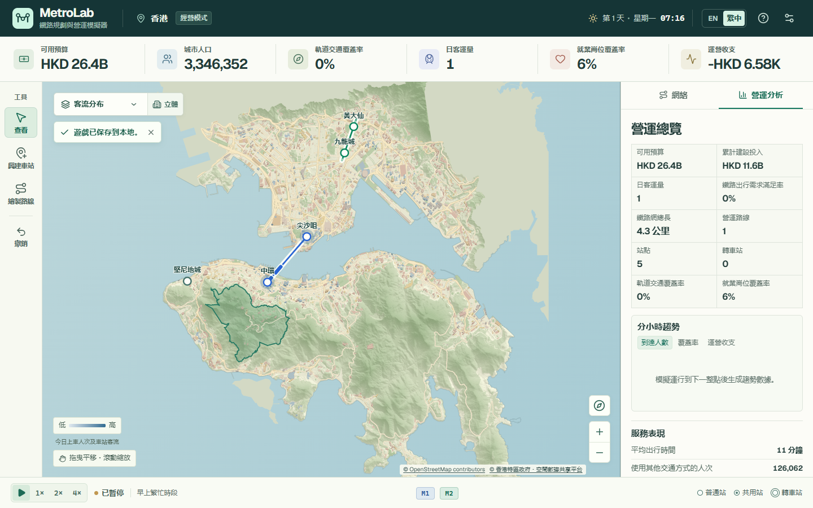

# MetroLab 2.0 · 香港

[English](README.md)

MetroLab 是一款以港島和九龍為背景的瀏覽器鐵路規劃與營運遊戲。玩家可按維港、山勢、街道和城市出行需求建立鐵路，並自行調整車費和班次。香港場景開局時鐵路網絡為空，底圖使用現代地理資料，人口和就業以 2021 年為基準。

[開始遊戲](https://bruce666-ppp.github.io/MetroLab/) · [資料來源、授權與模擬方法](docs/HONG-KONG-DATA.md)

## 遊玩方式

1. **經營模式**提供 380 億港元啟動資金。**沙盒模式**提供不限額的建造預算。可切換人口密度、就業密度和出行需求圖層，點選統計區查看估算客流及主要目的地。
2. 用**繪製路線**工具在地圖設定走線。一般點擊加入控制點。按住 **Shift** 再點擊，或使用規劃工具列的加站按鈕，可加入車站。移動滑鼠時會即時預覽站名，每個加入的車站也會在地圖上顯示名稱。可先建軌再加站，也可從合適的現有總站延伸路線。
3. 選擇地下、高架或地面建造方式。地下走線可經海底隧道過海，建造前須讓走線兩端落在陸地。規劃面板會列出距離、工程限制、不同建造方式、車站費用及確認後預算。確認建造後才扣款。
4. 用**興建車站**工具獨立建站，或點選已建軌道加站。多條軌道重疊時可選擇停靠路線。站名從附近的雙語地名取得，玩家可以分別修改中英文名稱。建站及搬站須避開水域、公園、景區和保護區。可在詳情面板搬遷車站、編輯走線及拆除區段。
5. 購置列車，設定車費與班次後啟動時間。客流圖層及營運總覽會更新候車、載客、收入、支出和覆蓋。票務收入在乘客完成鐵路行程後入帳。

**V** 切換至檢視、**S** 興建車站、**L** 繪製路線、**空白鍵**暫停或恢復時間，**Esc** 取消。**Ctrl/⌘+Z** 可復原規劃，或復原暫停時最近的施工。拖曳可平移地圖，滾輪及縮放按鈕可調整比例。



## 資料與存檔

海岸、道路及補充地名來自 OpenStreetMap。地政總署提供 5 米地形、建築輪廓及高度與雙語地名。香港政府統計處人口普查提供 105 個小規劃統計區的人口，規劃署資料提供九個區議會分區的 2021 年就業估計。網格人口、步行覆蓋、分時出行和鐵路客流均為模型結果。運輸署調查用於校準整體出行量、過海規模及繁忙時段。 [完整資料說明](docs/HONG-KONG-DATA.md)

遊戲會自動存檔，也可在設定手動存檔、讀取或重設。香港地名和介面跟隨使用者選擇的英文或香港繁體中文顯示。存檔格式第 4 版可讀取舊版 Marlow 存檔。

現有場景涵蓋港島、九龍和維港。工法限制使用地形、海岸及建築佔地的遊戲化規則。就業崗位按建築活動權重分配，巴士及渡輪採用估計的路上行程、碼頭步行接駁和候車時間。資料說明記錄高度缺失處理、就業統計粒度、工程參數和出行模型的適用範圍。 [資料來源與估算方法](docs/HONG-KONG-DATA.md)

## 本機開發

使用 Node.js 24 或以上及 npm。倉庫包含運行所需的資料。

```sh
npm ci
npm test
npm run build
npm run preview
```

在另一個終端執行 `npm run test:browser` 驗證正式構建。可用 `METROLAB_CHROME` 指定 Chromium，並用 `METROLAB_URL` 修改預覽網址。推送至 `main` 後，現有 GitHub Actions 流程測試、構建及發佈 `/MetroLab/`。 [部署流程](.github/workflows/pages.yml)
